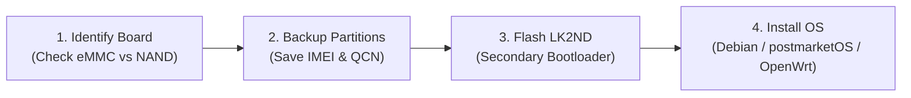

Welcome to the OpenStick community! This guide takes you through the fundamental workflow of taking a stock Qualcomm MSM8916 4G LTE USB modem and transforming it into a hackable Linux device.

:::caution[Golden Rule: Always Backup First!]
Every physical modem has unique radio calibration partitions (`fsg`, `modemst1`, `modemst2`) that store your factory IMEI and cellular frequency calibrations. If you wipe these partitions without a backup, your modem will permanently lose cellular connectivity. **Never skip the backup step!**
:::

---

## The 4-Step Road to Linux

### Step 1: Identify Your Hardware
Before plugging in your device or flashing any images, pop open the plastic snap-on cover and inspect the circuit board:
- Check the board model silkscreen (e.g., `UFI001B_MB_V02`, `UFI003`, `UZ801_V2.2`).
- Confirm whether your flash chip is **eMMC** (black BGA chip with pins underneath) or **NAND** (rectangular chip with visible side legs). eMMC has first-class mainline Linux support.
- 👉 Read the full [Device Identification Guide](/getting-started/device-identification/) to match your exact revision.

### Step 2: Extract & Save Your Calibration Data
Connect your device to a computer. Use Qualcomm EDL mode or `adb` root access to dump your partition table and modem calibration partitions:
- `modemst1`
- `modemst2`
- `fsg`
- `fsc`

Store these files safely in cloud storage or a secondary drive.
- 👉 Follow the detailed [Emergency Backup & Safety Checklist](/getting-started/backup-safety/).

### Step 3: Install Essential Drivers & Tools
Install the necessary developer tools on your host computer:
- `fastboot` and `adb` (Android platform tools)
- `edl.py` (Qualcomm Emergency Download Mode programmer tool)
- Qualcomm 9008 USB drivers (Windows) or standard `udev` rules (Linux/macOS)
- 👉 See [Essential Tools Setup](/getting-started/tools-setup/).

### Step 4: Follow the Guide for Your Board
Consult the dedicated guide for your specific hardware board to find exact test points, pinouts, and flashing steps:
- **[UZ801 Flashing Guide](/boards/uz801/flashing/)**: For Yiming / Zhihe UZ801 dongles.
- **[HMUF02 Flashing Guide](/boards/hmuf02/flashing/)**: For HMUF02 white-label sticks.
- **[HM-MIFIB Flashing Guide](/boards/hm-mifib/flashing/)**: For portable MiFi routers with color LCD screen & battery.
- **[UFI001B / UFI001C Flashing Guide](/boards/ufi001/flashing/)**: For reference OpenStick wingles.
- **[UFI003 Flashing Guide](/boards/ufi003/flashing/)**: For the 1GB RAM / 8GB eMMC flagship.
- **[SP970 Flashing Guide](/boards/sp970/flashing/)**: For SP970 V3 / V10 dongles.

---

## What Can You Do Once It's Running?

Once booted into Linux, your dongle connects to your computer over USB with full Ethernet networking (`192.168.68.1`). You can:
1. `ssh user@192.168.68.1` to access a full Bash terminal.
2. Run standard `apt update && apt install` packages.
3. Configure cellular internet with `mmcli` / NetworkManager.
4. Host web apps, run automation bots, or build home automation nodes.
