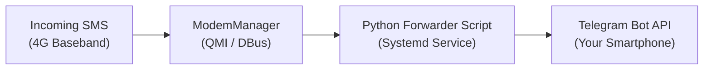

One of the most practical and popular uses for an MSM8916 modem is creating a **private SMS gateway**. 

Because the dongle contains a native cellular baseband and runs full Linux, it can intercept incoming SMS messages (such as bank 2FA codes, service registrations, or alerts) and instantly forward them to a Telegram group or Discord webhook.

---

## Architecture



---

## 1. Prerequisites
- An MSM8916 modem running Debian (OpenStick) or postmarketOS.
- An active SIM card inserted in the slot.
- `modemmanager` and `python3` installed.
- A Telegram Bot Token from `@BotFather`.

---

## 2. Install Dependencies

SSH into your dongle:

```bash
sudo apt update
sudo apt install -y python3-pip python3-dbus python3-gi
pip3 install requests --break-system-packages
```

---

## 3. The Python Forwarder Script

Create `/opt/sms_forwarder.py`:

```python
import subprocess
import json
import time
import requests

TELEGRAM_BOT_TOKEN = "YOUR_TELEGRAM_BOT_TOKEN_HERE"
TELEGRAM_CHAT_ID = "YOUR_TELEGRAM_CHAT_ID_HERE"

def send_telegram(message):
    url = f"https://api.telegram.org/bot{TELEGRAM_BOT_TOKEN}/sendMessage"
    payload = {"chat_id": TELEGRAM_CHAT_ID, "text": message, "parse_mode": "HTML"}
    try:
        requests.post(url, json=payload, timeout=10)
    except Exception as e:
        print(f"Failed to send to Telegram: {e}")

def check_messages():
    # Query ModemManager for SMS list in JSON format
    result = subprocess.run(["mmcli", "-m", "0", "--messaging-list-sms", "-J"], capture_output=True, text=True)
    if result.returncode != 0:
        return

    try:
        data = json.loads(result.stdout)
        sms_list = data.get("modem.messaging.sms", [])
        for sms_path in sms_list:
            sms_id = sms_path.split("/")[-1]
            # Fetch message details
            detail = subprocess.run(["mmcli", "-s", sms_id, "-J"], capture_output=True, text=True)
            sms_data = json.loads(detail.stdout).get("sms", {})
            sender = sms_data.get("content", {}).get("number", "Unknown")
            text = sms_data.get("content", {}).get("text", "")

            # Forward to Telegram
            msg = f"📩 <b>New SMS Received!</b>\n<b>From:</b> <code>{sender}</code>\n\n{text}"
            send_telegram(msg)

            # Delete processed SMS from SIM card
            subprocess.run(["mmcli", "-m", "0", f"--messaging-delete-sms={sms_id}"])
    except Exception as e:
        print(f"Error parsing SMS: {e}")

if __name__ == "__main__":
    send_telegram("🚀 OpenStick SMS Gateway Bot Started!")
    while True:
        check_messages()
        time.sleep(5)
```

---

## 4. Run Automatically as a Systemd Service

Create `/etc/systemd/system/sms-forwarder.service`:

```ini
[Unit]
Description=OpenStick SMS to Telegram Gateway
After=ModemManager.service network-online.target
Wants=network-online.target

[Service]
Type=simple
User=root
ExecStart=/usr/bin/python3 /opt/sms_forwarder.py
Restart=always
RestartSec=10

[Install]
WantedBy=multi-user.target
```

Enable and start the service:

```bash
sudo systemctl daemon-reload
sudo systemctl enable --now sms-forwarder.service
```

---

## 5. Testing
Send a text message from any mobile phone to the SIM card in the dongle. Within 5 seconds, your Telegram app will ding with the complete message text and sender information!
